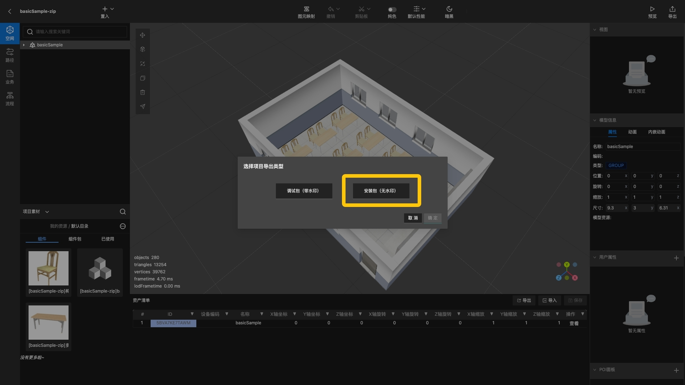
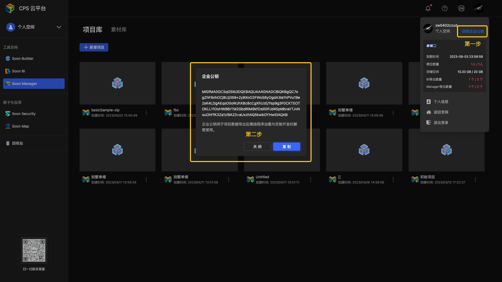

# plugin-cps-soonmanager


[CPS 平台](https://sooncps.xwbuilders.com/workspace/manager) 生产的场景加载及数据读取。

此插件基于 [soonmanager2-sync](./soonmanager2-sync) 扩展。3.0 alpha 保留原生场景加载路径，但移除旧自动合批 API，不能视为 2.x 的完全兼容升级。

## 样例

<Docs-Iframe src="plugin/cpsSoonmanager.html" />

## 安装

下面的命令安装已发布的 alpha；当前稳定标签仍是 2.x。本页远程 iframe 是既有原生样例，不证明其部署版本已升级为 alpha。

```bash
npm install soonspacejs@3.0.0-alpha.0 @soonspacejs/plugin-cps-soonmanager@3.0.0-alpha.0
```

## 使用方法

```js {2,10-14}
import SoonSpace from 'soonspacejs';
import CpsSoonmanagerPlugin from '@soonspacejs/plugin-cps-soonmanager';

const ssp = new SoonSpace({
  el: '#view',
  options: {},
  events: {},
});

// 如需加载多个场景请注册多个插件
const cpsSoonmanagerPlugin = ssp.registerPlugin(CpsSoonmanagerPlugin, 'cpsSoonmanagerPlugin');
cpsSoonmanagerPlugin.setPath('xxx');
await cpsSoonmanagerPlugin.loadScene();
```

## Entity 场景加载（3.0 alpha）

::: warning 3.0 alpha 预览
本节对应已发布的 `3.0.0-alpha.0`，接口仍可能发生破坏性变更。请按 [安装说明](../guide/#install) 固定 SDK、插件与 peer 依赖，不能混用 2.x 插件。

以下接口不会自动替换 `loadScene`、`loadSceneAndSemantic` 或其业务 API。旧接口仍按本页其他章节使用。
:::

新路径把业务层级保存在 Entity 中，渲染树只保留合批后的对象和真正需要的原生附件，不再把每个业务节点的空 Object3D 结构挂入 Scene。父子矩阵和继承显隐由 Entity 的已提交状态维护，业务编辑后需要主动调用 `notifyChange`。

先阅读 [Entity 入门](../guide/entity)、[Entity API](../api/entities) 与 [迁移指南](../guide/entity-migration)。模型共享、资源释放和合批边界分别见 [模型资源](../api/model-resources) 与 [性能](../api/performance)。

### loadEntityScene

读取完整 CPS 场景包，完成元数据读取、授权和树解码，再将模型与树中受支持的语义节点导入 Entity。

#### 定义

```ts
loadEntityScene(
  options?: Omit<CpsEntityPackageOptions, 'path'> & { path?: string }
): Promise<CpsEntityPackageScene>;

interface CpsEntityPackageOptions extends CpsEntityTreeOptions {
  path: string;
  key?: string;
  asId?: 'id' | 'sid';
}

interface CpsEntityPackageScene {
  path: string;
  metadata: IMetadata;
  scene: CpsEntityScene;
  requiresWatermark: boolean;
}
```

#### 用法

```ts
import SoonSpace from 'soonspacejs';
import CpsSoonmanagerPlugin from '@soonspacejs/plugin-cps-soonmanager';

const ssp = new SoonSpace({
  el: '#view',
  options: {},
  events: {},
});
const cps = ssp.registerPlugin(CpsSoonmanagerPlugin, 'cps');

// 使用压缩模型时，在第一次加载前配置相应解码器。
ssp.setModelDracoDecoderPath('/decoders/draco/');
ssp.setModelKtx2DecoderPath('/decoders/basis/');

const controller = new AbortController();
const result = await cps.loadEntityScene({
  path: '/scene-package',
  asId: 'sid',
  signal: controller.signal,
  // key: applicationPublicKey, // 可选：企业应用公钥，不是私钥。
});

console.log(result.metadata.name, result.requiresWatermark);
const bounds = ssp.entities.getBounds(result.scene.root);
if (!bounds.isEmpty()) await ssp.controls.fitToBox(bounds, true);

const room = result.scene.getBySourceId('room-source-sid');
if (room) {
  room.visible = false;
  room.notifyChange('visibility');
}

// 仅释放这个加载会话；不会清空其他消费者的 Entity 或 GIS。
// result.scene.dispose();
```

#### 参数与返回值

| 参数 | 说明 | 默认行为 |
| --- | --- | --- |
| `path` | 场景包根路径；支持包内相对路径解析及现有 CPS 查询代理路径形式。 | 本次显式传值 → 当前 Entity 包的 `path` → 插件 `path`；最终不能为空。 |
| `key` | 本次授权使用的应用**公钥**。 | 使用插件已配置的公钥；本次覆盖不会修改插件默认凭据。 |
| `asId` | 选择用于会话内源 ID 查询的字段。 | `sid`；缺失或为空时回退到 `id`。 |
| `signal` | 取消当前加载。 | 不取消其他消费者持有的共享模型资源。 |
| `idForNode` | 自定义节点的源 ID，返回非空且在本次树中唯一的字符串。 | 优先于 `asId`。 |
| `resolveModelURL` | 将 `3D` 节点解析为模型 URL。 | 使用包根路径与解码树中的 `node.path`；参见资源支持范围。 |
| `loadModel` | 自定义模型导入，返回 `Promise<ModelLease>`。 | 使用 `ssp.models.load`；回调存在时由它加载，但仍会先调用 `resolveModelURL`。 |
| `createAttachment` | 自定义非 `GROUP` / `STUB` / `3D` 节点工厂。 | 使用本插件内置的受支持语义工厂；显式传入时完全替换默认工厂。 |
| `beforeCommit` | 全部候选内容准备完成、显示前的同步检查。 | 抛出异常时放弃候选会话并保留之前的会话。**不能返回 Promise。** |

`CpsEntityTreeOptions` 及工厂返回结构见 [共享导入选项](#共享导入选项)。返回值包含本次包的路径、元数据、Entity 会话和水印要求；读取元数据不意味着其中所有平台设置都已应用。

#### 加载、授权与切换

1. 读取 `SceneMetadata.json`，按包内规则读取 `db/flat_models` 和树资源。
2. 元数据版本 `>= 1.2` 时，复用现有 CPS 授权策略和 v1 / v2 签名、解密逻辑；更早版本读取明文树。
3. 在隐藏的会话根 Entity 下创建候选节点，以最多 4 个并发任务加载模型或附件。
4. 候选内容全部成功、同步检查和必要水印显示完成后，整体激活并释放本加载器的旧会话。

调试包仍遵循现有水印规则，不能通过新 API 绕过授权或水印。`key` 只能传应用公钥；不要把签名或服务端私钥放进前端。包 JSON 在包加载入口捕获 SDK 请求头快照；每个模型在模型加载入口独立捕获已配置 loader 的请求头，不保证与包 JSON 的快照相同。模型根请求及同来源标准 glTF 依赖使用该模型的快照，其他来源依赖不继承凭据；携带凭据的可信来源依赖拒绝重定向。宿主解码器、自定义 handler 与模型工厂须自行处理鉴权、跨域和重定向，见 [模型请求边界](../api/model-resources#gltf-请求头与来源边界)。

加载失败、取消或被同入口的新请求替代时，不会把半成品作为当前场景显示，之前已接受的会话保留。已开始的解码工作可能继续完成，但过期结果会被释放，不会覆盖新会话。`signal` 只控制加载过程，已接受会话的销毁应调用 `scene.dispose()`。

`loadEntityScene` 与 `loadEntityTree` 会协调取消另一 Entity 入口的待处理请求，并在成功切换后清理另一入口的会话。它们不会自动移除旧 `loadScene` 创建的 Object3D 场景；不要在同一个内容上重复调用两套加载路径。

::: tip 独立状态
新包入口不覆写旧的 `path`、`metaData`、`treeData` 属性。查询本次 Entity 包应读取返回值或 `getEntityScene()`，不能依赖旧属性跟随更新。
:::

#### 资源与语义支持范围

- 默认 `3D` 资源支持静态 `.glb` / `.gltf`，以及 `SBMG----` 字节封装的 `.sbmx`。原始 `.sbm` 不支持，需同时提供可解析该路径的 `resolveModelURL` 和 `loadModel` 适配器，避免默认 URL 扩展名检查先拒绝资源。Draco / KTX2 使用 SoonSpace 现有解码配置。
- URL 模型中的静止姿态变换轨道可接受；实际变换动画、骨骼、Morph 和多材质 Mesh 不在该静态资源导入范围内。
- `GROUP` / `STUB` 只生成逻辑 Entity。内置语义工厂支持 `POLYGON`、`CIRCLE`、`AREA`、`FLOOR`、`ROOM`、`OUTSIDE`、`BUILDING`、`DOOR`、`STAIRCASE`、`ELEVATOR`、`VENT`、`WINDOW`、`ZONE`、`WATER_SOURCE`、`ENTRANCE`；其他类型需显式提供工厂。
- 语义工厂生成后，可转换的静态 Mesh 叶节点会成为共享模型快照：相同兼容几何使用 InstancedMesh，不同兼容几何使用 BatchedMesh；材质颜色可作为成员色保存，不因房间随机颜色无谓拆批。
- 快照保存 Mesh 相对语义节点的矩阵和初始继承显隐；节点自身的 `matrix` 由 Entity 应用一次。线条等剩余渲染内容保留为附件，空语义结构不挂入 Scene。依赖骨骼、LOD、灯光、CSS 或自定义渲染回调的原生层级按需要保留上下文。
- 兼容的单面、普通混合、非透射透明语义 Mesh 可使用批内排序的 BatchedMesh。**跨批次以及与其他透明对象之间的精确交错排序暂未解决**；有精确混合要求的内容需保持独立绘制。

::: warning 不是 loadSceneAndSemantic 的直接替代
首期尚未迁移独立 `semantic_model.json` 加载管线、GIS / POI / Work ID / 自定义属性，以及包中其余预设和业务设置的完整应用。新入口支持的是模型和**树内受支持语义节点**，不是旧场景业务能力的等价替换。

Entity 合批开关和统计由 `ssp.entities` 管理。3.0 alpha 已移除 `cps.setAutoInstancing()`、`cps.getAutoInstancingStats()` 及原生加载选项 `autoInstancing`。
:::

### getEntityScene

```ts
getEntityScene(): CpsEntityPackageScene | null;
```

返回最近成功接受的 `loadEntityScene` 结果；尚无完整包会话时返回 `null`。它不会返回 `loadEntityTree` 的会话，后者需要保存方法返回值。

```ts
const currentPackage = cps.getEntityScene();
const root = currentPackage?.scene.root;
```

### loadEntityTree

只导入调用方已解码的 CPS 树，**不读取完整包元数据、不执行授权或签名验证**。传入数据的来源和访问控制由调用方负责。

```ts
loadEntityTree(
  nodes?: ITreeData[] | null,
  options?: CpsEntityTreeOptions
): Promise<CpsEntityScene>;
```

省略 `nodes` 时使用插件已有的 `treeData`；尚未准备树数据会抛出异常。`nodes` 必须是无循环的树，选定的源 ID 必须非空且唯一。节点矩阵需包含 16 个有限数值，并且是可分解、重新组合为 TRS 的仿射矩阵，支持零缩放和镜像。往返验证的逐元素容限为 `1e-8 * max(1, abs(sourceElement))`。超出容限的局部剪切或透视矩阵会明确拒绝，不静默近似，已接受会话保留。正常嵌套 TRS 产生的世界剪切另由 Entity 渲染器回退独立对象保真处理。

```ts
// decodedTree 由应用自己的合法解码 / 解析流程提供。
const session = await cps.loadEntityTree(decodedTree, {
  idForNode: node => node.sid || node.id,
  resolveModelURL: node => {
    if (!node.path) throw new Error(`模型缺少 path: ${node.id}`);
    return new URL(node.path, 'https://example.com/scene-package/').href;
  },
  signal: controller.signal,
});

const entity = session.getBySourceId('source-sid');
```

该示例只适用于 `GROUP` / `STUB` / `3D` 树；含语义节点时还需传入 `createAttachment`。`loadEntityTree` 不会自动采用完整包入口的内置语义工厂。URL 示例要求树节点实际带有 `path`；如果模型路径单独存储，应从自己的路径表解析。

此方法默认使用 `sid`（字段缺失时回退 `id`）；可以通过 `idForNode` 改为其他源 ID。默认 URL 解析依赖插件已有的节点路径表和 `path`，且只接受 `.glb` / `.gltf`。对于新解码树或 `.sbmx`，应显式提供 `resolveModelURL`；其他格式应同时提供路径解析和返回静态模型 lease 的 `loadModel`。

它同样采用隐藏候选根、有限并发、取消和成功后替换机制；不会自动加载 POI / GIS 等包级业务。

### 共享导入选项

以下类型从 `@soonspacejs/plugin-cps-soonmanager` 导出，适用于两个新入口。`loadEntityTree` 的实际参数是插件的 `ITreeData[]`，工厂参数使用下列较小的公开节点结构。

```ts
import type { Object3D } from 'three';
import type { ModelLease } from 'soonspacejs';

interface CpsEntityTreeNode {
  id: string;
  sid?: string;
  name: string;
  renderType: string;
  matrix: readonly number[];
  visible: boolean;
  children: readonly CpsEntityTreeNode[];
  path?: string | null;
}

interface CpsEntityTreeOptions {
  signal?: AbortSignal;
  idForNode?: (node: CpsEntityTreeNode) => string;
  resolveModelURL?: (node: CpsEntityTreeNode) => string;
  loadModel?: (
    node: CpsEntityTreeNode,
    signal: AbortSignal
  ) => Promise<ModelLease>;
  createAttachment?: (
    node: CpsEntityTreeNode,
    signal: AbortSignal
  ) => Promise<CpsEntityAttachment>;
  beforeCommit?: () => void;
}

interface CpsEntityAttachment {
  object: Object3D;
  model?: ModelLease;
  empty?: boolean;
  release: () => void;
}
```

工厂约定：

- `loadModel` 返回一个调用方 lease。加载器为 Entity 保留资源后会释放该 lease，包括取消和失败路径；工厂不应提前释放它。
- 即使配置了 `loadModel`，仍会先运行 `resolveModelURL`。自定义格式或路径表应同时覆盖解析函数，不能让默认解析先报错。
- `createAttachment` 返回离场的 Object3D；根节点应使用单位局部变换，子节点保留相对变换。不要再次应用 CPS 节点的 `matrix`，它属于 Entity。
- 可选 `model` 表示工厂已提取的静态模型 lease。加载器将它绑定到 Entity，并释放工厂交出的 lease；`object` 只放未转换的剩余内容，避免同一 Mesh 被重复绘制。
- `empty: true` 表示没有剩余渲染内容，不再创建 Object3D 附件；仍需提供 `object` 和 `release`。
- `release` 只释放工厂自己拥有的对象、资源和缓存。会话释放或候选失败时由加载器调用，不能释放已转交 SDK 的共享资源；实现应避免重复清理。
- 工厂应响应传入的 `signal`；即使工厂晚返回，加载器也不会挂入过期结果，并会调用清理。
- `beforeCommit` 只做同步校验。异步准备请在工厂或方法调用前完成。

独立使用导出的 `CpsEntityTreeLoader` / `CpsEntityPackageLoader` 时，不会获得插件私有的语义工厂。完整包 loader 接受调试包时还需要提供同步水印显示函数；通常应优先使用上述插件入口。

独立 `CpsEntityTreeLoader` 默认以节点 `id` 查询，插件的 `loadEntityTree` 默认选择 `sid` 并回退到 `id`，两者不要混淆。高级 loader 提供 `load`、`cancelPending`、`dispose`，完整包 loader 另有只读 `current`；底层类型 `CpsPreparedPackage` 描述准备结果，但其 `prepare` 方法是私有实现。

```ts
interface CpsPreparedPackage {
  path: string;
  metadata: IMetadata;
  flatData: IFlatData[];
  tree: IInnerTreeData[];
  requiresWatermark: boolean;
}
```

### CpsEntityScene

```ts
class CpsEntityScene {
  readonly root: Entity;
  readonly bySourceId: Map<string, Entity>;
  getBySourceId(id: string): Entity | undefined;
  dispose(): void;
}
```

- `root` 是无模型的会话逻辑根，可通过 `position` / `quaternion` / `scale` 及 `notifyChange('transform')` 整体移动，也可用 `visible` 与 `notifyChange('visibility')` 控制整场显隐。
- `getBySourceId` 使用 `asId` / `idForNode` 选择的源 ID。Entity 的实际 `id` 带唯一会话前缀，不要用源 ID 调用旧 `ssp.getObjectById` 查询它。已删除的 Entity 不再返回。
- `bySourceId` 用于读取源 ID 映射，不应由业务增删其中记录。
- `dispose()` 可重复调用，释放本会话创建的 Entity、模型引用和工厂附件；即使业务把某个会话 Entity 从根节点下移出，它仍属于这个会话的释放范围。其他 owner 的内容不会被清空。

### 新路径的合批控制与统计

```ts
// 新 Entity 渲染路径，不是旧 CPS sceneGroup 的代理开关。
ssp.entities.setInstancingEnabled(true);
ssp.entities.setBatchedEnabled(true);
ssp.flushUpdates();

console.table(ssp.entities.getStats());
console.log(ssp.viewport.renderer.info.render.calls);
```

`getStats()` 是整个 EntityCollection 的统计，包含其他 Entity 消费者，不限于当前 CPS 会话。`independentObjects` 统计模型回退对象，不含全部原生附件；批次数也不等于整帧 draw calls。必须在同视角、分辨率与渲染配置下预热后测量 CPU / GPU 帧耗时，不能仅用这些数字判断性能达标。详细见 [性能验证](../api/performance)。

## 属性

### path

资源加载的基础路径

- **默认值:** `''`
- **类型:** `string`

### effectPlugin

特效插件实例

- **默认值:** `null`
- **类型:** `EffectPlugin | null`

```js
const effectPlugin = ssp.registerPlugin(EffectPlugin, 'effectPlugin');

cpsSoonmanagerPlugin.effectPlugin = effectPlugin;
cpsSoonmanagerPlugin.loadScene();
```

::: tip 提示
当 `renderType` 为 `WATER_SURFACE` 时，需要使用[特效插件](./effect)
:::

### sceneGroup

<Base-Tag title="readonly" />

场景 Group 对象

场景树的顶层对象会作为 sceneGroup 的 `children`。

```js
// Group 的默认 id 是 `path` 属性，可以通过 `getObjectById` 获取
const sceneGroup = ssp.getObjectById(path);
// 设置该场景的整体偏移
sceneGroup.position.set(10, 0, 0);
```

- **默认值:** `null`
- **类型:** `Group | null`

### metaData

<Base-Tag title="readonly" />

场景元数据

调用 [fetchMetaData](#fetchmetadata) 方法时会设置此属性

- **默认值:** `null`
- **类型:** `IMetadata | null`

#### 定义

```ts
interface IMetadata {
  platformVersion: number;
  version: number;
  name: string;
  projectId: string;
  sceneId: string;
  cover: string | null;
  flatModel: string;
  treeModel: string;
  resource: string;
  exportTime: number;
  environment?: string;
}
```

<!-- ### treeData

<Base-Tag title="readonly" />

场景树数据

调用 [loadScene](#loadscene) 方法时会设置此属性

- **默认值:** `null`
- **类型:** `ITreeData[] | null`

#### 定义

```ts
interface ITreeData {
  id: string;
  pid: string | null;
  sid: string;
  name: string;
  renderType: 'GROUP' | '3D' | 'ROOM' | 'STUB' | 'POLYGON' | 'CIRCLE' | 'WATER_SURFACE' | 'DECAL';
  deviceCode: string | null;
  matrix: number[];
  path: string | null;
  familyId: string | null;
  children: ITreeData[];
  visible: boolean;
  twinsIdentifier: string | null;
  shape?: {
    height: number;
    radius: number;
    points?: IVector3[];
  };
  boundingBox?: number[];
  extra?: {
    [key: string]: any;
  };
}
```

|    字段     |                  释义                  |
| :---------: | :------------------------------------: |
|     id      | 场景内对象的绑定 `id`，是以前的 `uuid` |
|     pid     |               父级的 id                |
|    name     |   对象的名称，作为对象的 `name` 属性   |
|     sid     |        数据库生成的唯一随机 id         |
| renderType  |             对象的渲染类型             |
| deviceCode  |                设备编码                |
|   matrix    |           对象的局部矩阵信息           |
|    path     |                资源路径                |
|  familyId   |          模型资源的组件 `id`           |
|  children   |              子对象的数组              |
|   visible   |           初始化对象是否可见           |
| twinsIdentifier |      Twins 系统中的对象标识       |
|    shape    |           多边形、水面等信息           |
| boundingBox |         房间等对象的包围盒数据         |
|    extra    |              一些额外信息              |

::: tip 检索对象的几种方式
除了 `children` 其他字段都会存在每个对象的 `userData` 上

```js
// 使用 `id` 获取
const model = ssp.getObjectById('xxx');

// 使用 `name` 获取
const [model] = ssp.getObjectByName('xxx');

// 假设定义了一个 deviceCode 为 kx-1
const [deviceModel] = ssp.getObjectByUserDataProperty('deviceCode', 'kx-1');
```

:::

::: warning 注意
`2024-08-09` 之后导出的版本，已经将现在的 `id` 作为之前的 `uuid`。

如果使用旧版资源包或者新版资源包使用 `id`，使用 `loadScene` 方法时传入 `{ asId: 'id' }`。
::: -->

### poiData

<Base-Tag title="readonly" />

场景内配置 Poi 数据, 该数据在加载场景（loadScene）时自动获取。

- **默认值:** `null`
- **类型:** `IPoiData[] | null`

#### 定义

```ts
export enum PoiContentTypeEnum {
  PANEL = 'PANEL',
  VIDEO = 'VIDEO',
  VIDEO_STREAM = 'VIDEO_STREAM',
}

interface IPoiData {
  projectId: string;
  sceneId: string;
  nodeId: string;
  poiId: string;
  name: string;
  width: number;
  height: number;
  x: number;
  y: number;
  z: number;
  rotationX: number;
  rotationY: number;
  rotationZ: number;
  scale: number;
  dimensional: PoiNodeType;
  content: string;
  media: Record<string, string> | null;
  contentType: PoiContentTypeEnum;
  display: boolean;
  style: string;
}
```

### topologyData

<Base-Tag title="readonly" />

拓扑路径数据

调用 [getTopologies](#gettopologies) 方法时会设置此属性

- **默认值:** `null`
- **类型:** [`TopologyInfo[]`](../api/topology#topologyinfo) | `null`

### propertiesData

<Base-Tag title="readonly" />

自定义属性数据，根据 `modelId` 分组

调用 [fetchPropertiesData](#fetchpropertiesdata) 方法时会设置此属性

- **默认值:** `null`
- **类型:** `TPropertiesMap | null`

#### 定义

```ts
interface IProperties {
  modelId: string;
  group: string;
  key: string;
  value: string | null;
  label: string | null;
}

type TPropertiesMap = Map<IProperties['modelId'], IProperties[]>;
```

### animationsData

<Base-Tag title="readonly" />

补间动画数据，根据 `modelId` 分组

调用 [fetchAnimationsData](#fetchanimationsdata) 方法时会设置此属性

- **默认值:** `null`
- **类型:** `TAnimationsMap | null`

#### 定义

```ts
interface IKeyframe {
  id: string;
  uuid: string;
  x: number;
  y: number;
  z: number;
  scaleX: number;
  scaleY: number;
  scaleZ: number;
  rotationX: number;
  rotationY: number;
  rotationZ: number;
  easing: AnimationModeType;
  mode: string;
  delay: number;
  duration: number;
  repeat: number;
  yoyo: boolean;
}

/**
 * 动画
 */
interface IAnimations {
  id: string;
  uuid: string;
  modelId: string;
  name: string;
  keyframes: IKeyframe[];
}

type TAnimationsMap = Map<IAnimations['modelId'], IAnimations[]>;
```

### modelVisionsData

<Base-Tag title="readonly" />

模型视角数据，根据 `nodeId` 分组

调用 [fetchModelVisionsData](#fetchmodelvisionsdata) 方法时会设置此属性

- **默认值:** `null`
- **类型:** `TModelVisionsMap | null`

#### 定义

```ts
interface IModelVisions {
  id: string;
  uuid: string;
  nodeId: string;
  name: string;
  camera: 'O' | 'P';
  position: IVector3;
  rotation: IVector3;
  target: IVector3;
  zoom: number;
  primary: boolean;
}

type TModelVisionsMap = Map<IModelVisions['nodeId'], IModelVisions[]>;
```

::: tip 提示
Map 的 key 为 "" 时，表示场景视角数据
:::

### spacesData

<Base-Tag title="readonly" />

模型视角数据，根据 `sid` 分组

调用 [fetchSpacesData](#fetchspacesdata) 方法时会设置此属性

- **默认值:** `null`
- **类型:** `TSpacesMap | null`

#### 定义

```ts
interface ISpaces {
  id: string;
  sid: string;
  name: string;
  type: string;
  matrix: number[];
  visible: boolean;
  // treeData 中的 id 列表
  assets: string[] | null;
  children: ISpaces[] | null;
}

export type TSpacesMap = Map<ISpaces['sid'], ISpaces>;
```

### soonflow

<Base-Tag title="readonly" />

流程执行引擎实例

- **类型:** [SoonFlow](https://www.npmjs.com/package/@soonflow/core)

### flowData

<Base-Tag title="readonly" />

场景中配置好的流程数据，数据可提供给 [runFlowById](#runflowbyid) 使用。

- **默认值:** `null`
- **类型:** `any[] | null`

## 方法

### setKey

设置企业公钥

::: tip 提示
如下图，只有使用 **安装包** 需去除场景水印时才需要设置企业公钥。


获取企业公钥, 请联系 CPS 平台企业 **管理员** 按下图提示操作获取。


整体设计逻辑

| 资源包类型 | 是否需要设置企业公钥 | 是否携带水印 |
| :--------: | :------------------: | :----------: |
|   调试包   |          否          |      是      |
|   安装包   |          是          |      否      |
| 旧版资源包 |          否          |      否      |

:::

#### 定义

```ts
function setKey(key: string): void;
```

#### 用法

```js
cpsSoonmanagerPlugin.setKey('xxxxxxxxxxxxxxxx');
```

::: warning 注意
需要在调用 `loadScene` 之前调用 `setKey` 方法，否则安装包将无法正常加载
:::

### setPath

设置加载资源的基础路径

#### 定义

```ts
function setPath(path: string): void;
```

#### 用法

```js
cpsSoonmanagerPlugin.setPath('./models');
// or
cpsSoonmanagerPlugin.setPath('http://xxx.com/models');
```

::: warning 注意
插件的其他方法依赖于 `path`，需要先设置才能使用
:::

### loadScene

加载场景对象

配合 `loadTargetId` 或 `loadLevel` 使用可以重复调用

#### 定义

```ts
export enum LoadSceneAlgorithm {
  BFS = 'BFS', // 广度优先
  DFS = 'DFS', // 深度优先
}
```

```ts
interface ILoadSceneOptions {
  /**
   * 平台解密公钥
   */
  key?: string;
  /**
   * 资源包路径
   */
  path?: string;
  /**
   * 同步自定义属性
   */
  syncProperties?: boolean;
  /**
   * 同步模型视角数据
   */
  syncModelVisions?: boolean;
  /**
   * 计算 bounds tree
   */
  needsModelsBoundsTree?: boolean;
  /**
   * 应用预设效果
   */
  applyPresetEffects?: boolean;
  /**
   * 同步场景算法 BFS | DFS
   */
  loadSceneAlgorithm?: LoadSceneAlgorithm;
  /**
   * 目标节点 id（DFS时有效）
   */
  loadTargetId?: ITreeData['id'];
  /**
   * 需要加载的层级（DFS时有效）
   */
  loadLevel?: number;
  /**
   * v2.10.x
   * 需要隐藏的对象 id
   */
  hiddenObjects?: Set<string>;
  /**
   * 加载 poi
   */
  loadPoi?: boolean;
  /**
   * 通过数据源刷新 poi
   */
  refreshPoiByDataSource?: boolean;
  /**
   * 加载流程数据
   */
  loadFlowData?: boolean;
  /**
   * 场景 group 信息
   */
  sceneGroupInfo?: Partial<BaseObjectInfo>;
  /**
   * 对象 id 前缀
   */
  objectPrefixId?: string;
  /**
   * 作为对象的 id
   */
  asId?: 'id' | 'sid';
}

function loadScene(options?: ILoadSceneOptions): Promise<void>;
```

#### 用法

```js
// 进度事件
cpsSoonmanagerPlugin.addEventListener('progressing', ({ progress }) => {
  console.log((progress.loaded / progress.total) * 100 + '% loaded');
});

cpsSoonmanagerPlugin
  .loadScene()
  .then(() => {
    console.log('场景对象加载完成');
  })
  .catch((err) => {
    // key 验证失败时会触发此错误
    console.error(err);
  });
```

::: tip 提示
某些模型文件可能应用了 [DRACO](https://google.github.io/draco/) 压缩，建议调用 loadScene 方法之前调用 [setModelDracoDecoderPath](../api/model.md#setmodeldracodecoderpath) 方法设置 DRACO 解压路径
:::

::: tip 提示
如果你需要使用 Worker 计算 BVH，可以关闭默认行为

```js
await cpsSoonmanagerPlugin.loadScene({ needsModelsBoundsTree: false });

await ssp.computeModelsBoundsTree({
  type: 'worker',
  workerCreator,
});
```

具体请查看 [computeModelsBoundsTree](../api/model#computemodelsboundstree)

默认的 `needsModelsBoundsTree: true` 会在场景对象加载完成后启动分片计算，但 `loadScene()` 不等待 BVH 全部完成。如果后续逻辑依赖 BVH 已可用，请关闭默认行为并像上例一样手动 `await ssp.computeModelsBoundsTree()`。

:::

::: tip 提示

初始化加载大场景时，可以通过 `loadSceneAlgorithm` 参数设置加载场景算法为`BFS`，可以提升部分加载时间。

```ts
import { LoadSceneAlgorithm } from '@soonspacejs/plugin-cps-soonmanager';

cpsSoonmanagerPlugin
  .loadScene({
    loadSceneAlgorithm: LoadSceneAlgorithm.BFS,
  })
  .then(() => {
    ssp.flyMainViewpoint();

    console.log('场景对象加载完成');
  });
```

:::

#### 参数

##### options

- **描述:** 场景加载选项
- **必填:** <Base-RequireIcon :isRequire="false"/>
- **类型:** `ILoadSceneOptions`

##### ILoadSceneOptions

<Docs-Table
    :data="[
      { prop: 'key', desc: '等价于 setKey 方法', type: 'string', require: false, default: '' },
      { prop: 'path', desc: '等价于 setPath 方法', type: 'string', require: false, default: '' },
      { prop: 'syncProperties', desc: '是否同步自定义属性，开启时自动调用 fetchPropertiesData 方法', type: 'boolean', require: false, default: 'true' },
      { prop: 'syncModelVisions', desc: '是否同步节点视角数据，开启时自动调用 fetchModelVisionsData 方法', type: 'boolean', require: false, default: 'true' },
      { prop: 'needsModelsBoundsTree', desc: '场景加载完成后在后台调用 ssp.computeModelsBoundsTree；loadScene 不等待 BVH 全部完成', type: 'boolean', require: false, default: 'true' },
      { prop: 'applyPresetEffects', desc: '默认调用 presetEffects 方法', type: 'boolean', require: false, default: 'true' },
      { prop: 'loadSceneAlgorithm', desc: '加载场景使用的算法', type: 'LoadSceneAlgorithm', require: false, default: 'LoadSceneAlgorithm.DFS' },
      { prop: 'loadTargetId', desc: '加载的目标树节点id', type: 'string', require: false, default: '' },
      { prop: 'loadLevel', desc: '加载的树层级。如果设置了loadTargetId，则以此为起始层。从1开始计算', type: 'number', require: false, default: 'Infinity' },
      { prop: 'hiddenObjects', desc: '初始化隐藏的对象 id 集合', type: 'Set&lt;string&gt;', require: false, default: '' },
      { prop: 'loadPoi', desc: '默认执行 loadPoi 方法', type: 'boolean', require: false, default: 'false' },
      { prop: 'refreshPoiByDataSource', desc: '默认执行 refreshPoiByDataSource 方法', type: 'boolean', require: false, default: 'false' },
      { prop: 'loadFlowData', desc: '默认执行 loadFlowData 方法', type: 'boolean', require: false, default: 'false' },
      { prop: 'sceneGroupInfo', desc: '场景 group 信息', type: 'Partial<BaseObjectInfo>', require: false, default: '{id: [this.path]}' },
      { prop: 'objectPrefixId', desc: '场景对象的id前缀', type: 'string', require: false, default: '' },
      { prop: 'asId', desc: '作为对象 id 的字段', type: 'id | sid', require: false, default: 'sid' },
    ]"
/>

::: tip 提示
自定义属性存储在对象的 `userData.properties` 属性上
:::

::: tip twinsIdentifier 对象查询
`ITreeData.twinsIdentifier` 会随场景加载写入对应对象的 `extraIds`。字段为非空字符串时，可以继续使用现有的对象查询 API：

```js
const object = ssp.getObjectById(treeNode.twinsIdentifier);
```

字段为 `null` 或空字符串时不会写入 `extraIds`，原有 `id`、`sid` 查询方式不变。
:::

::: tip 原生加载与渲染请求
原生 `loadScene`、`loadSceneAndSemantic` 和 worker 路径不再自动合批。需要 Entity 模型批处理时，显式迁移到 [loadEntityScene](#loadentityscene)，先确认其业务支持范围。

初始化期间不需要渐进显示时，可以暂停渲染，完成加载后在 finally 中恢复；这只合并绘制请求，不会把原生对象转换成 Entity。

```js
await ssp.viewport.setPauseRender(true);
try {
  await cpsSoonmanagerPlugin.loadSceneAndSemantic();
} finally {
  await ssp.viewport.setPauseRender(false);
}
```
:::

###### 分层加载示例

<Docs-Iframe src="plugin/cpsSoonmanagerLevel.html" />

::: warning 警告
由于场景模型是嵌套的树结构，内部对象的矩阵变换依赖父级，如果先加载内部，可能会出现位置、旋转、缩放的错乱

建议 `loadTargetId` 设置为上层节点的 id
:::


### presetEffects

设置预设效果，参数来源由平台渲染后导出。

#### 定义

```ts
interface IPresetEffectsOptions {
  hdr?: boolean;
  ssao?: boolean;
  directionalLightShadow?: boolean | { angle?: number };
  toneMappping?: boolean;
}

function presetEffects(options?: IPresetEffectsOptions): Promise<void>;
```

#### 用法

```js
await cpsSoonmanagerPlugin.loadScene({
  applyPresetEffects: false,
});
await cpsSoonmanagerPlugin.presetEffects({
  hdr: true,
  ssao: true,
  directionalLightShadow: true,
  toneMappping: true,
});
```

#### 参数

##### options

- **描述:** 效果参数
- **必填:** <Base-RequireIcon :isRequire="false"/>
- **类型:** `IPresetEffectsOptions`

##### IPresetEffectsOptions

<Docs-Table
    :data="[
      { prop: 'hdr', desc: '使用资源包中预设的 hdr 环境', type: 'boolean', require: false, default: 'true' },
      { prop: 'ssao', desc: '开启 SSAO  效果', type: 'boolean', require: false, default: 'true' },
      { prop: 'directionalLightShadow', desc: '开启平行光阴影', type: 'boolean', require: false, default: 'true' },
      { prop: 'toneMappping', desc: '设置 toneMappping', type: 'boolean', require: false, default: 'true' },
    ]"
/>

_各参数对应的方法_
| 参数 | 对应的内部方法 |
| :--------------------: | :----------------------------------------------------: |
| hdr | [setEnvironment](../api/sceneTool#setenvironment) |
| ssao | [setSSAO](../api/sceneTool#setssao) |
| directionalLightShadow | [createDirectionalLight](../api/light#createdirectionallight) |
| toneMappping | [setToneMapping](../api/sceneTool.html#settonemapping) |

::: warning 注意
presetEffects 需要等待场景加载完调用
:::

### getTopologies

获取拓扑路径数据

#### 定义

```ts
function getTopologies(): Promise<TopologyInfo[]>;
```

#### 用法

```js
const topologiesInfo = await cpsSoonmanagerPlugin.getTopologies();

/**
 * 每个数组元素对应一个拓扑路径
 * 使用获取到的数据直接创建拓扑路径
 */
ssp.createTopology(topologiesInfo[0]);
ssp.createTopology(topologiesInfo[1]);
ssp.createTopology(topologiesInfo[2]);
```

### sortTopologyNodes

对拓扑路径数据的 nodes 进行排序（只适用于线路）

#### 定义

```ts
function sortTopologyNodes(topologyInfo: TopologyInfo, startNodeId?: TopologyNodeInfo['id']): TopologyInfo | undefined;
```

#### 用法

```js
const [topologyInfo] = await cpsSoonmanagerPlugin.getTopologies();

/**
 * 没有 startNodeId 则默认第0个 node 为起始 node
 */
const sortedToplogyInfo = cpsSoonmanagerPlugin.sortTopologyNodes(topologyInfo);

ssp.createTopology({
  ...sortedToplogyInfo,
  imgUrl: 'xxx.png',
  animation: true,
});
```

::: tip 提示
在播放路径动画或使用[巡检插件](./patrol-controls)时会按照 nodes 数组的顺序执行

所以可能需要使用此方法对线路的 nodes 排序
:::

### playObjectAnimation

根据动画数据播放对象的补间动画

#### 定义

```ts
type TAnimationsTweenProps = Pick<
  IKeyframe,
  'x' | 'y' | 'z' | 'rotationX' | 'rotationY' | 'rotationZ' | 'scaleX' | 'scaleY' | 'scaleZ'
>;

interface IPlayAnimationByIdOptions {
  autoStopPrevious?: boolean;
  onUpdate?: (source: TAnimationsTweenProps, tween: Tween<TAnimationsTweenProps>) => void;
  onStart?: (tween: Tween<TAnimationsTweenProps>) => void;
}

function playObjectAnimation(
  object: BaseObject3D,
  animationIndex?: number,
  options?: IPlayAnimationByIdOptions
): Promise<boolean>;
```

#### 用法

```js
const object = ssp.getObjectByUserDataProperty('deviceCode', '111');
cpsSoonmanagerPlugin.playObjectAnimation(object, 0, {
  autoStopPrevious: true,
  onUpdate: (source, tween) => {},
  onStart: (tween) => {
    /**
     * 包含多个帧动画时，每个动画帧开始时 onStart 都会执行
     */
    console.log(tween);
  },
});
```

#### 参数

##### object

- **描述:** 要播放动画的对象
- **必填:** <Base-RequireIcon :isRequire="true"/>
- **类型:** `BaseObject3D`

##### animationIndex

- **描述:** 该动画所在数据列表中的下标
- **必填:** <Base-RequireIcon :isRequire="false"/>
- **默认值:** `0`
- **类型:** `number`

##### options

- **描述:** 动画播放选项
- **必填:** <Base-RequireIcon :isRequire="false"/>
- **类型:** `IPlayAnimationByIdOptions`

##### IPlayAnimationByIdOptions

<Docs-Table
    :data="[
      { prop: 'autoStopPrevious', desc: '是否自动停止之前的动画', type: 'boolean', require: false, default: 'true' },
      { prop: 'onUpdate', desc: '动画更新回调', type: 'IPlayAnimationByIdOptions[\'onUpdate\']', require: false, default: '' },
      { prop: 'onStart', desc: '动画开始回调', type: 'IPlayAnimationByIdOptions[\'onStart\']', require: false, default: '' },
    ]"
/>

::: tip 提示
动画播放时，可以是多个 `animation` 的组合

所以每次执行新的 `animation` 方法时都会执行 `onStart` 回调并且返回新的 `tween` 实例
:::

### stopObjectAnimation

停止由 [playObjectAnimation](#playobjectanimation) 方法触发的补间动画

#### 定义

```ts
function stopObjectAnimation(object: BaseObject3D): Promise<boolean>;
```

#### 用法

```js
cpsSoonmanagerPlugin.stopObjectAnimation(object);
```

### flyToSceneFromVisionsData

根据场景视角数据飞向

#### 定义

```ts
function flyToSceneFromVisionsData(index?: number): Promise<boolean>;
```

#### 用法

```js
cpsSoonmanagerPlugin.flyToSceneFromVisionsData(0);
```

#### 参数

##### index

- **描述:** 该视角所在数据列表中的下标
- **必填:** <Base-RequireIcon :isRequire="false"/>
- **类型:** `number`

### flyToMainSceneFromVisionsData

根据场景视角数据飞向主视角

#### 定义

```ts
function flyToMainSceneFromVisionsData(fallback?: boolean): Promise<boolean>;
```

#### 用法

```js
const success = await cpsSoonmanagerPlugin.flyToMainSceneFromVisionsData();
```

#### 参数

##### fallback

- **描述:** 没有主视角时，是否默认调用 [`flyMainViewpoint`](../api/camera#flymainviewpoint)。默认是 `true`
- **必填:** <Base-RequireIcon :isRequire="false"/>
- **类型:** `boolean`

### flyToObjectFromVisionsData

根据对象视角数据飞向

#### 定义

```ts
function flyToObjectFromVisionsData(object: BaseObject3D, index?: number): Promise<boolean>;
```

#### 用法

```js
const model = ssp.getObjectByUserDataProperty('device', 'xxx');

cpsSoonmanagerPlugin.flyToObjectFromVisionsData(model, 0);
```

#### 参数

##### object

- **描述:** 场景对象
- **必填:** <Base-RequireIcon :isRequire="true"/>
- **类型:** `BaseObject3D`

##### index

- **描述:** 该视角所在数据列表中的下标
- **必填:** <Base-RequireIcon :isRequire="false"/>
- **类型:** `number`

### flyToMainObjectFromVisionsData

根据对象视角数据飞向默认视角

#### 定义

```ts
function flyToMainObjectFromVisionsData(object: BaseObject3D, fallback?: boolean): Promise<boolean>;
```

#### 用法

```js
const model = ssp.getObjectByUserDataProperty('device', 'xxx');

const success = await cpsSoonmanagerPlugin.flyToMainObjectFromVisionsData(model);
```

#### 参数

##### object

- **描述:** 场景对象
- **必填:** <Base-RequireIcon :isRequire="true"/>
- **类型:** `BaseObject3D`

##### fallback

- **描述:** 没有默认视角时，是否默认调用 [`flyToObj`](../api/camera#flytoobj)。默认是 `true`
- **必填:** <Base-RequireIcon :isRequire="false"/>
- **类型:** `boolean`

### getSpaceAssets

获取空间下辖设备列表

#### 定义

```ts
function getSpaceAssets<T extends BaseObject3D = BaseObject3D>(space: BaseObject3D): Promise<T[]>;
```

#### 用法

```ts
const [spaceObject] = ssp.getObjectByUserDataProperty('space', 'xxx');
const spaceAssets = await cpsSoonmanagerPlugin.getSpaceAssets(spaceObject);
```

#### 参数

##### space

- **描述:** 空间对象
- **必填:** <Base-RequireIcon :isRequire="true"/>
- **类型:** `BaseObject3D`

### loadPoi

根据 poiData 渲染 Poi。

::: tip 使用提示
如果 `loadScene` 时参数 `loadPoi` 已设置开启将自动执行，无需手动调用。
:::

#### 定义

```ts
function loadPoi(refreshByDataSource: boolean): Promise<void>;
```

#### 用法

```ts
cpsSoonmanagerPlugin.loadPoi(true);
```

#### 参数

##### refreshByDataSource

- **描述:** 加载完调用 [refreshPoiByDataSource](#refreshbydatasource)
- **必填:** <Base-RequireIcon :isRequire="false"/>
- **类型:** `boolean`

### refreshPoiByDataSource

通过数据源刷新 Poi

::: tip 使用提示
如果 `loadScene` 时参数 `refreshPoiByDataSource` 或手动执行 `loadPoi` 时 `refreshPoiByDataSource` 已设置开启都将自动执行，无需手动调用。
:::

#### 定义

```ts
function refreshPoiByDataSource(): Promise<void>;
```

#### 用法

```ts
cpsSoonmanagerPlugin.loadPoi();
cpsSoonmanagerPlugin.refreshPoiByDataSource();
```

### loadFlowData

加载场景的流程数据

::: tip 使用提示
如果 `loadScene` 时参数 `loadFlowData` 已设置开启将自动执行，无需手动调用。
:::

#### 定义

```ts
function loadFlowData(): Promise<void>;
```

#### 用法

```ts
// 假设执行第一条流程
cpsSoonmanagerPlugin.loadFlowData().then(() => {
  console.log('流程数据加载完成');
});
```

### runFlowById

手动执行场景流程，流程 id 可在 [flowData](#flowdata) 中获取。

::: warning 使用提示
使用该方法时必须确保 `loadFlowData` 已执行完成，`loadFlowData` 可通过 `loadScene` 参数 `loadFlowData` 配置开启自动加载 或 手动调用 `loadFlowData` 方法。
:::

#### 定义

```ts
function runFlowById(id: string): Promise<void>;
```

#### 用法

```ts
// 假设执行第一条流程
cpsSoonmanagerPlugin.runFlowById(cpsSoonmanagerPlugin.flowData[0].id);
```

### fetchMetaData

根据当前 `path` 获取场景元数据

由 [loadScene](#loadscene) 方法调用

#### 定义

```ts
function fetchMetaData(): Promise<IMetadata>;
```

#### 用法

```ts
cpsSoonmanagerPlugin.fetchMetaData().then((metaData) => {
  console.log(fetchMetaData);
});
```

### fetchTreeData <Base-Deprecated />

根据当前 `path` 获取场景树数据

#### 定义

```ts
function fetchTreeData(): Promise<ITreeData[]>;
```

#### 用法

```ts
cpsSoonmanagerPlugin.fetchTreeData().then((treeData) => {
  console.log(treeData);
});
```

::: warning 注意
此方法已不适用于加密资源包
:::

### fetchPropertiesData

根据当前 `path` 获取自定义属性数据

由 [loadScene](#loadscene) 方法调用

#### 定义

```ts
function fetchPropertiesData(): Promise<TPropertiesMap>;
```

#### 用法

```ts
cpsSoonmanagerPlugin.fetchPropertiesData().then((propertiesData) => {
  console.log(propertiesData);
});
```

### fetchAnimationsData

根据当前 `path` 获取补间动画数据

由 [playAnimationById](#playanimationbyid) 方法调用

#### 定义

```ts
function fetchAnimationsData(): Promise<TAnimationsMap>;
```

#### 用法

```ts
cpsSoonmanagerPlugin.fetchAnimationsData().then((animationsData) => {
  console.log(animationsData);
});
```

### fetchModelVisionsData

根据当前 `path` 获取模型视角数据

由 [flyToSceneFromVisionsData](#flytoscenefromvisionsdata) 和 [flyToObjectFromVisionsData](#flytoobjectfromvisionsdata) 方法调用

#### 定义

```ts
function fetchModelVisionsData(): Promise<TModelVisionsMap>;
```

#### 用法

```ts
cpsSoonmanagerPlugin.fetchModelVisionsData().then((modelVisions) => {
  console.log(modelVisions);
});
```

### fetchSpacesData

根据当前 `path` 获取空间数据

由 [getSpaceAssets](#getspaceassets) 方法调用

#### 定义

```ts
function fetchSpacesData(): Promise<Map<string, ISpaces>>;
```

#### 用法

```ts
cpsSoonmanagerPlugin.fetchSpacesData().then((spacesData) => {
  console.log(spacesData);
});
```

## FDS 体数据

`CpsSoonmanagerPlugin` 内置 `FdsManager`，可以读取场景中的 `fds.json`，也可以直接传入 URL 或 FDS 数据项。

### loadFDS

```ts
loadFDS(
  input?: string | IFdsData | Array<string | IFdsData>,
  options?: {
    field?: 'temperature' | 'soot_density' | 'hrrpuv'
  }
): Promise<VolumePoints[]>
```

```ts
await cpsSoonmanagerPlugin.loadFDS(undefined, {
  field: 'temperature',
})
```

不传 `input` 时，插件会读取 `fetchFDSData()` 的可见数据源；没有有效数据源时回退到当前场景目录下的默认 FDS 数据文件。

### 播放控制

| API | 返回值 | 说明 |
| --- | --- | --- |
| `getFDSState()` | `IFdsManagerState` | 获取活动体、时间、帧和播放状态。 |
| `playFDS()` | `boolean` | 播放当前活动体。 |
| `pauseFDS()` | `boolean` | 暂停。 |
| `toggleFDSPlay()` | `boolean` | 切换播放状态。 |
| `setFDSTime(timeSec, options?)` | `Promise<VolumePoints \| null>` | 跳到指定秒数；`options.wait` 默认为 `true`。 |
| `clearFDS()` | `number` | 移除全部 FDS 体对象并返回数量。 |

更底层的 FDS 数据结构与事件见 [plugin-fds](./fds)。

## 补充数据读取 API

以下方法直接读取并返回对应场景资源。不同加载流程会按需要缓存其中一部分结果；不要假定直接调用每个 `fetch*` 都会更新同名属性。

| API | 返回值 |
| --- | --- |
| `fetchSemanticData()` | `Promise<SemanticObject>` |
| `fetchRoadsData()` | `Promise<IRoadsData>` |
| `fetchFlatData()` | `Promise<IFlatData[]>` |
| `fetchPoiData()` | `Promise<IPoiData[]>` |
| `fetchDataSourceData()` | `Promise<any>` |
| `fetchTopologyData()` | `Promise<ITopologyPath[]>` |
| `fetchFlowsData()` | `Promise<FlowType[]>` |
| `fetchGisData()` | `Promise<IGisData>` |
| `fetchGisPlotsData()` | `Promise<IGisPlot[]>` |
| `fetchFDSData()` | `Promise<IFdsData[]>` |

`loadTopologies()` 会读取 `fetchTopologyData()` 并为每条数据调用 `ssp.createTopology()`；`presetGis()` 会按元数据初始化地形、倾斜摄影、影像和 GeoJSON。

::: warning presetGis 生命周期
不要把 `presetGis()` 当作可重复刷新的 API。部分地形分支会创建新的 renderer 并覆盖当前引用，重复调用前不会先释放旧实例。通常应由 `loadScene*` 流程调用一次。
:::

## Work ID 映射

### applyWorkIdMap

```ts
applyWorkIdMap(
  workIdMap?: IWorkIdMap | null
): IApplyWorkIdMapResult
```

```ts
const result = cpsSoonmanagerPlugin.applyWorkIdMap({
  'scene-object-id': { work_id: 'business-object-id' },
})
```

映射会把 `work_id` 写入对象 `userData`、`extraIds` 和 SoonSpace 对象缓存。尚未加载的目标会保留为 pending，并在对象创建后继续应用。

```ts
interface IApplyWorkIdMapResult {
  received: number
  accepted: number
  applied: number
  pending: number
  invalid: number
  duplicates: number
}
```

## 其他公开方法

| API | 说明 |
| --- | --- |
| `refreshByUserData()` | 注册属性变化监听并同步 POI。应只调用一次，避免重复监听。 |
| `runWithCode(fn)` | 通过 SoonSpace `utils.runWithCode` 执行函数。 |
| `getTreeNodeById(id, treeData, options)` | 递归查询树节点。第三个参数使用内部加载选项，业务通常无需直接调用。 |
| `dispose()` | 中止语义加载，并释放 FDS、道路、场景 Group、大气和当前地形/tiles。 |

::: warning refreshByUserData 生命周期
`refreshByUserData()` 注册的 `propertiesChanged` 监听不会由 `dispose()` 移除，`dispose()` 也不会清空 `objectsAnimations`。只在插件与 SoonSpace 实例同生命周期时启用该监听；销毁前应先停止业务持有的动画。
:::
